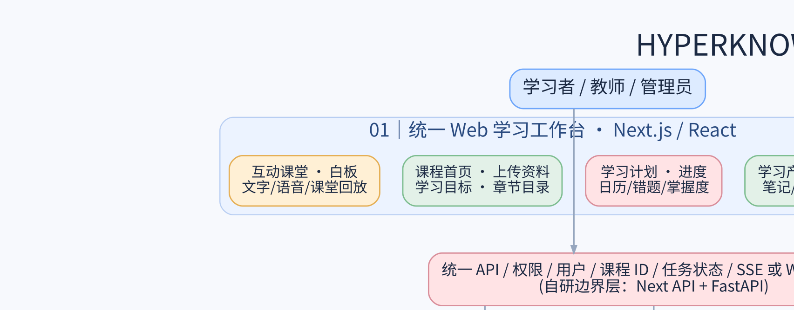

# Hyperknow 开源复刻：功能匹配、许可证、成熟度、整合难度与可执行方案
> 调研时间：2026-10-19。基于 Hyperknow 官网公开介绍与 GitHub 仓库 README/许可证；未对全部仓库进行源代码安全审计，也未完整登录核查 Hyperknow 付费流程。

## 结论和边界
最可控的路线：**自研统一教育数据模型与教学中枢；复用成熟的开源基础组件；借鉴 Open Notebook 与 LibreNote AI 的成品工作流。** 不建议把多个完整产品强行合并为一个仓库，否则账户、数据库和异步任务会产生耦合冲突。

核心要保留的产品体验：输入学习目标→上传材料→学习水平诊断→生成课程→AI讲解/实时提问/白板→测验反馈→掌握度更新→智能复习/日历→生成笔记/速查表/视频。

说明：Hyperknow 官网已证实课程生成、导学、资料上传、生成测验/闪卡/速查表/讲解视频、任务规划、个性化记忆。实时白板手势、直播语音打断等具体交互纳入“目标能力”，尚不能宣称与官方实现完全相同。

## 技术架构图

## A. 逐项功能对照表
| 功能 | 候选开源 | 复用策略 | 难度 | 必须完成的集成开发 |
|---|---|---|---|---|
| 账号、学习工作台、个人课程 | LibreNote AI / Next.js | 改造 | 中 | 课程体系、角色权限、用户间隔离、统一仪表盘 |
| PDF/Word/PPT/网页/音视频上传 | Docling + Faster Whisper + LibreNote | 直接+改造 | 中 | OCR/分块/音频异步处理/文件配额 |
| 源材料引证式问答与检索 | pgvector + Open Notebook/LangGraph | 改造 | 中 | 引用精确页码/片段、混合召回、严格按课程过滤 |
| 从目标自动规划一整套课程 | LangGraph | 自研 | 高 | 诊断目标→先修知识图谱→大纲→章节→评测标准 |
| 教师式逐步讲课与苏格拉底追问 | LangGraph + Tutori参考 | 自研 | 很高 | 教学状态机、节奏控制、提问反馈、错误纠正 |
| 可编辑互动白板、AI画图 | Excalidraw + Tutori参考 | 改造 | 很高 | 结构化板书指令、图形验证、重放/撤销、语音同步 |
| 语音提问/课堂实时对话 | Faster Whisper + CosyVoice | 改造 | 高 | 打断检测、延迟优化、同步字幕、状态持久化 |
| 笔记/总结/速查表/FAQ | Open Notebook / LibreNote | 直接+改造 | 低-中 | 教学来源锚点、导出模板、二次编辑 |
| 测验/习题/答案解析 | LibreNote + 自研评测 | 改造 | 中 | 答案验证、难度分层、主观题评分、错题回灌 |
| 闪卡与间隔复习 | ts-fsrs + LibreNote | 直接+改造 | 低-中 | 卡片生成可复用、计划与历史结果需统一 |
| 知识图谱/思维导图 | LibreNote + Mermaid | 直接+改造 | 中 | 概念关系、错误链路、知识掌握度叠加 |
| 两分钟AI讲解视频 | Manim + CosyVoice + FFmpeg | 改造 | 高 | 脚本→场景→动画→配音→字幕→媒体输出 |
| 长期学习记忆与掌握度 | Mem0偏好记忆 + Cortex参考 + 自研状态表 | 自研 | 很高 | 偏好与学习掌握度分离，证据、遗忘/复习策略、权限和可解释性 |
| 日历/DDL/任务安排 | FullCalendar + Trigger.dev | 改造 | 中 | 课程进度映射任务、依赖、通知、重排 |
| 多课程数据与教师模式切换 | 自研接口/数据模型 | 自研 | 高 | 统一对象ID与共享学习状态，不同模型自动路由 |
| 费用与稳定性/运营监控 | Trigger.dev + Playwright | 改造 | 中-高 | 多租户预算、审计日志、失败重试、权限和安全 |

## B. 仓库/许可证/成熟度选型矩阵
评价口径：成熟度是架构与仓库规模/维护度的工程判断，并非第三方认证。整合难度“低/中/高”针对统一 Web SaaS 平台。

| 项目 | 代码许可证 | 工程成熟度（估计） | 归类 | 整合难度 | 适用范围与注意事项 |
|---|---|---|---|---|---|
| [Open Notebook](https://github.com/lfnovo/open-notebook) | MIT | 高 | 参考/可复用后端 | 中 | 完整文档工作台、RAG引证、笔记、音频；独立SurrealDB体系，且偏单用户 |
| [LibreNote AI](https://github.com/devyanshyadav/librenote-ai) | MIT | 低-中 | 备选可Fork底座 | 中 | Next.js/Supabase、登录、RAG、闪卡、测验、思维导图；仓库小，需先跑集成测试 |
| [Cortex](https://github.com/PndaMan/cortex) | Apache-2.0 | 中（产品早期） | 参考/移植算法 | 高 | 闪卡FSRS、学习分析、日历、讲义；Tauri/Rust/Svelte桌面架构 |
| [NotebookLM-Lite](https://github.com/LRriver/NotebookLM-Lite) | Apache-2.0 | 低-中 | 备选学习资料工作流 | 中 | 思维导图/报告/闪卡/音频/幻灯片；视频功能尚为占位 |
| [Docling](https://github.com/docling-project/docling) | MIT | 高 | 直接复用 | 低-中 | PDF/PPTX/DOCX布局解析与结构化抽取；OCR/依赖另行核查 |
| [pgvector](https://github.com/pgvector/pgvector) | PostgreSQL License | 高 | 直接复用 | 低 | PG向量检索，和课程/用户表同库存储 |
| [LangGraph](https://github.com/langchain-ai/langgraph) | MIT | 高 | 直接复用编排框架 | 中 | 可恢复状态图/工具调用；教学策略、课程策划仍需自研 |
| [Mem0](https://github.com/mem0ai/mem0) | Apache-2.0 | 高 | 可选复用学习者偏好记忆 | 中 | 持久个人偏好/上下文记忆；不能代替客观知识掌握度的评估表 |
| [Graphiti](https://github.com/getzep/graphiti) | Apache-2.0 | 高 | 可选知识图谱增强 | 中-高 | 可追溯实体关系/时间语义；通常需要额外图数据库，先不上MVP |
| [Mermaid](https://github.com/mermaid-js/mermaid) | MIT | 高 | 直接复用示意图生成 | 低 | 知识关系、流程图、章节结构图，非完全手绘可编辑白板 |
| [Excalidraw](https://github.com/excalidraw/excalidraw) | MIT | 高 | 直接复用画布/二次开发事件协议 | 中 | 可编辑矢量白板，需开发AI板书命令与语音同步 |
| [Tutori](https://github.com/SSHdotCodes/tutori) | Apache-2.0 | 低（演示型） | 二次开发/架构参考 | 中-高 | 语音+连续手绘板书、图形命令；Gradio工程需迁移到Web |
| [AI Tutor with Live Whiteboard](https://github.com/sairam356/AI-Tutor-with-Live-Whiteboard) | MIT（仓库） | 低（演示型） | 仅参考工作流 | 高 | React/LangGraph.js/tldraw；tldraw正式商用需独立购买许可证 |
| [HeyTutor](https://github.com/kaizen403/heytutor) | 未确认许可证 | 低-中 | 仅作技术参考 | 不建议复制源码 | 验证图形后再同步讲解；目前未核实可授权复制代码 |
| [ts-fsrs](https://github.com/open-spaced-repetition/ts-fsrs) | MIT | 中-高 | 直接复用 | 低 | 闪卡间隔复习调度，学习掌握度仍需自研 |
| [Faster Whisper](https://github.com/SYSTRAN/faster-whisper) | MIT | 高 | 直接复用 | 低-中 | 语音识别/音频转写；实时流式与话轮管理需额外实现 |
| [CosyVoice](https://github.com/QwenAudio/CosyVoice) | Apache-2.0（代码；模型单独核查） | 高（研发活跃） | 直接复用TTS服务 | 中-高 | 中文语音授课，可流式；服务器GPU、模型和第三方依赖许可证需核查 |
| [Manim Community](https://github.com/ManimCommunity/manim) | MIT | 高 | 直接复用渲染引擎 | 中-高 | 数学/机制动画画面；自动教学脚本、配音、字幕、视频拼装自研 |
| [FullCalendar Standard](https://github.com/fullcalendar/fullcalendar) | MIT（标准版） | 高 | 直接复用日历UI | 低 | 日程视图与拖拽；Premium不是免费商用 |
| [Trigger.dev](https://github.com/triggerdotdev/trigger.dev) | Apache-2.0（仓库） | 高 | 直接复用任务系统 | 中 | 后台课程生成、异步视频任务、重试、定时队列；托管服务另算 |
| [Playwright](https://github.com/microsoft/playwright) | Apache-2.0 | 高 | 直接复用测试工具 | 低-中 | 自动化端到端操作回归；测试样例仍需自己设计 |

## C. 推荐主技术栈（不强行兼容全部整套产品）

- Web：Next.js + React + TypeScript；用户登录、工作台、课程详情与教室自研。
- 可选偏好记忆 Mem0；知识图谱 Graphiti 可在后续有真实需求时上线，避免 MVP 被额外图数据库拖慢。
- 核心 API：FastAPI（Python）；跨端用户/课程/资产状态通过统一 API 合同提供。
- 教学引擎：LangGraph Python，LLM 供应商可替换；严格分离“提示词思考”和“可验证状态机”。
- RAG：Docling → 结构化块（页码/图表/来源 ID）→ Embedding → PostgreSQL/pgvector；必要时加关键词检索与重排。
- 画布：Excalidraw SDK；AI 不输出自由文本作为绘图代码，而是输出 JSON board commands→验证器→渲染/重放。
- 语音：ASR Faster Whisper、TTS CosyVoice（或早期云服务提供者），通过流式接口桥接；口型/语音同步为后续增强。
- 练习：结构化题库+答题评估；ts-fsrs 负责闪卡日程，掌握度由评测表现单独计算。
- 视频：讲稿/脚本由LLM辅助生成→结构化分镜→Manim/HTML渲染→CosyVoice配音→FFmpeg合成并存储。
- 日历与异步：FullCalendar Standard；Trigger.dev / Celery 只选其一，依据队伍 TypeScript/Python 比重决定。
- 资产：Postgres 存元数据/权限，S3兼容对象存储保留原文件、音视频、白板快照，统一云端模型网关。

## D. 为什么不是直接 Fork 任意单个项目

1. Open Notebook（MIT）研发社区明显更成熟，但它使用 Python/FastAPI/Next.js/SurrealDB，且有“先单用户”的架构取舍；可先作为独立知识引擎原型或参考数据流程，千万不要默认能够开箱多租户。
2. LibreNote AI（MIT）自带 Next.js、Supabase、多用户隔离及 Studio，符合新平台结构，但当前仓库约十几颗星、约二十多个提交，仍属早期，需要先跑数据隔离与导入功能 POC 才能决定是否 Fork。
3. Cortex（Apache 2.0）复习/日历/学习数据优秀，但核心是 Tauri + Rust + Svelte 的单机应用，直接转 Web 的移植代价高。
4. Tutori（Apache 2.0）提供很好的“语音+画图”流程模板，但 Gradio 演示代码不等于可投入生产的低延迟多用户教室。
5. HeyTutor 没有在仓库首页找到明确 LICENSE；仅学习架构，不复制源代码，除非项目方明确授权。

## E. 必须自研的教学中枢：共享数据合同

最低必需数据表：users, courses, lessons, objectives, prerequisite_edges, sources, source_chunks, teaching_sessions, teacher_actions, board_events, questions, attempts, mastery_evidence, mastery_state, review_cards, review_logs, study_tasks, assets, model_runs, audit_logs。

统一事件：`LessonStarted`、`TutorExplained`、`TutorAsked`、`AnswerSubmitted`、`AnswerEvaluated`、`BoardActionCommitted`、`MasteryUpdated`、`ReviewScheduled`、`AssetGenerated`。

教学循环示例：学习目标诊断→从RAG取得课程出处→选择教学策略（解释/举例/反问/练习）→流式文字与板书→测验/回答评分→将证据写入 mastery_evidence→更新 mastery_state→建立下一次复习与学习任务。

关键要求：对事实性知识建立来源引用，对计算/公式类答案增加规则引擎或可执行校验；图形布局需要检验，避免 AI 乱画；学生输入内容不能直接执行成脚本。

## F. 实施步骤、验收门槛

### 第 0 步｜验证真实产品范围（1个工作包）
- 人工录屏 Hyperknow 免费版和允许使用的付费功能，记录所有按钮、工作流、输出类型、状态变化、失败反馈；制作“功能证据-截图-目标-验收”表。
- 验收：每个功能都有来源链接或录屏证据；公开功能/推断功能/目标创新清楚分列。

### 第 1 步｜两个底座快速试验
- 分别部署 Open Notebook 与 LibreNote AI 的隔离环境；用同一套教材验证导入、引用准确、题目生成、重启恢复与两用户隔离。
- 验收：记录成功/失败日志与数据模型；选择“一套主资料系统”，不要两套并行长期存储；低成熟度 Fork 不通过可退回独立 Next.js + Docling + pgvector。

### 第 2 步｜最小教学闭环 MVP
- 自研 Course/Objective/Lesson，连接 LangGraph 教师，先用纯文字问答和题库评估，再实现学习状态持久化。
- 验收：一个用户上传 PDF → 输出引用课程 → 完成三节课 → 练习反馈 → 下次打开续学；跨课程无数据泄漏。

### 第 3 步｜音视频可视化课堂
- 先整合 Excalidraw 与 JSON 绘图事件，具备录制/重播；再接 Whisper/CosyVoice，建立字幕/声画序列号。
- 验收：用户能打断/追问、老师转入新步骤、白板可重播，异常恢复不乱序。

### 第 4 步｜学习产物与复习
- 接入生成题库/笔记/速查表/闪卡；ts-fsrs 回顾计划、FullCalendar 可视化，学习证据进入掌握度。
- 验收：生成物都可追溯到资料源；答错题触发后续针对性练习而非仅记录分数。

### 第 5 步｜视频和商业上线
- 生成讲稿→分镜→Manim动画→TTS→FFmpeg；加入异步队列、计费配额、安全审核、观测、E2E 回归。
- 验收：失败可恢复/重试，成本可见，存在视频生成质量检查，且多人并发不互相串数据。

## G. 许可证与法务检查清单
- MIT、Apache-2.0、BSD 与 PostgreSQL License 通常允许商用和修改，但务必保留著作权声明与必要 NOTICE，审查传递性依赖/模型许可证/音色权。
- tldraw 与“其衍生演示仓库有 MIT”是两个独立许可问题：tldraw 当前正式商用需生产许可证，不要因为上游教程许可 MIT 就直接商用 tldraw。
- FullCalendar 的 Standard 是 MIT，Premium 组件需要单独的商业许可。
- HeyTutor 未核实清晰许可，不能视为开源可自由复用。
- 文档与课程素材必须确认有上传/使用权，避免镜像复制 Hyperknow 的品牌、商标、受版权保护的视觉素材。
- 如果用 MarkItDown OCR / PyMuPDF 或 FFmpeg 的某些编解码配置，需额外检查 AGPL/GPL 等传递性条件。
- 上线前生成软件物料清单 SBOM、保留 third-party notices 并对所有打包依赖重新扫描。

## H. 用于研发的原始来源
- Hyperknow 官网：https://www.hyperknow.io/
- 视频特性：https://www.hyperknow.io/blogs/get-explainer-video
- 速查表说明：https://www.hyperknow.io/zh-cn/blogs/ai-cheatsheet-generator
- 官方理念：https://www.hyperknow.io/manifesto
- tldraw 授权：https://tldraw.dev/sdk-features/license-key
- FullCalendar 授权：https://fullcalendar.io/license
- pgvector 许可证：https://github.com/pgvector/pgvector/blob/master/LICENSE
- Open Notebook：https://github.com/lfnovo/open-notebook
- LibreNote AI：https://github.com/devyanshyadav/librenote-ai
- Cortex：https://github.com/PndaMan/cortex
- NotebookLM-Lite：https://github.com/LRriver/NotebookLM-Lite
- Docling：https://github.com/docling-project/docling
- pgvector：https://github.com/pgvector/pgvector
- LangGraph：https://github.com/langchain-ai/langgraph
- Mem0：https://github.com/mem0ai/mem0
- Graphiti：https://github.com/getzep/graphiti
- Mermaid：https://github.com/mermaid-js/mermaid
- Excalidraw：https://github.com/excalidraw/excalidraw
- Tutori：https://github.com/SSHdotCodes/tutori
- AI Tutor with Live Whiteboard：https://github.com/sairam356/AI-Tutor-with-Live-Whiteboard
- HeyTutor：https://github.com/kaizen403/heytutor
- ts-fsrs：https://github.com/open-spaced-repetition/ts-fsrs
- Faster Whisper：https://github.com/SYSTRAN/faster-whisper
- CosyVoice：https://github.com/QwenAudio/CosyVoice
- Manim Community：https://github.com/ManimCommunity/manim
- FullCalendar Standard：https://github.com/fullcalendar/fullcalendar
- Trigger.dev：https://github.com/triggerdotdev/trigger.dev
- Playwright：https://github.com/microsoft/playwright
